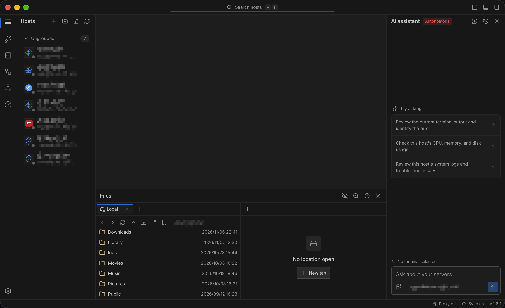

<div align="center">


# Sageport

**A unified workspace for SSH server management**

Manage terminal sessions, file transfers, resource monitoring, port forwarding, and scheduled workflows in one free, open-source desktop application.

[](https://github.com/joygqz/sageport/releases/latest)
[](LICENSE)
[](https://tauri.app)

English · [简体中文](README.zh-CN.md)

</div>



## Overview

Sageport is a free, open-source desktop application for SSH-based server management. It brings terminal sessions, SFTP file transfer, resource monitoring, port forwarding, and task automation into a unified workspace.

| Capability          | Description                                                                           |
| ------------------- | ------------------------------------------------------------------------------------- |
| Terminal sessions   | Manage multiple connections with tabs, split panes, and broadcast input               |
| File management     | Transfer files between local and remote systems and edit remote files in place        |
| Task automation     | Coordinate commands and file transfers with schedules, retries, and execution history |
| Resource monitoring | View CPU, memory, disk, and network metrics over SSH                                  |
| Command snippets    | Reuse parameterized commands across one or more hosts                                 |
| Port forwarding     | Manage local, remote, and dynamic SSH tunnels                                         |

- **Agentless access.** Connect through standard SSH and SFTP without installing a Sageport agent on remote hosts.
- **Local data storage.** Host configurations, credentials, settings, and execution history are stored on your device. No Sageport account or hosted service is required.
- **Explicit authorization.** Host key verification, destructive action confirmations, and AI approval controls help you review sensitive operations.

## Features

### Terminal

Manage SSH sessions with tabs and split panes. Reconnect sessions, search terminal scrollback, and use command autocomplete. Broadcast input to multiple connected terminals for coordinated operations. For an ad hoc connection, enter `user@host` in the command palette without creating a saved host.

### File management

Browse local and remote directories side by side, transfer files with drag and drop, and filter or sort directory contents. Edit remote files in the integrated Monaco editor with syntax highlighting and save changes directly to the server. Recursive deletion includes a preliminary scan, parallel execution, and progress reporting. Transfer records include source and destination details.

### Task automation

Define multi-step workflows using local commands, uploads, downloads, and remote commands. Built-in templates cover frontend and backend deployments, database backups, configuration distribution, and log collection. Configure step retries, inspect live output, and review persistent execution history.

Schedule tasks with cron expressions. Scheduled execution requires Sageport to remain running, either with an open window or in the system tray. The tray menu provides access to upcoming tasks and active port forwards.

### Hosts and credentials

Organize hosts into groups, reuse credentials through shared identities, and connect through jump-host chains. Import host configurations from `~/.ssh/config`, and generate, import, or manage SSH keys within the application.

### Resource monitoring

View live CPU, memory, disk, and network charts for connected hosts. Metrics are collected through the existing SSH session without deploying a monitoring agent.

### Command snippets

Save reusable commands with `{{variable}}` placeholders and supply values at execution time. Run snippets on individual hosts or across multiple hosts, with separate output and execution status for each host.

### Port forwarding

Configure local, remote, and dynamic (SOCKS) SSH forwarding, including connections through jump hosts. Start and stop tunnels from the workspace, or enable automatic startup for configured forwards.

### AI assistant

Configure an OpenAI- or Anthropic-compatible API endpoint with your own credentials and model. The assistant can use workspace context, propose and execute commands, manage files, and create automation tasks.

Reading terminal or remote file content requires approval. Other operations follow the configured approval policy. Autonomous mode allows eligible operations to run automatically, while operations influenced by untrusted content require renewed approval.

### Sync and backup

Optionally synchronize configuration across devices using GitHub Gist, Google Drive, OneDrive, WebDAV, or S3. Sync data is encrypted locally with your passphrase before upload. For offline backup, export an encrypted backup file.

### Workspace

Access features through the command palette and keyboard shortcuts. The interface supports light and dark themes, English and Simplified Chinese, and a JSON settings editor with schema validation.

## Installation

Download a package from the [latest release](https://github.com/joygqz/sageport/releases/latest):

| Platform                        | Package                             |
| ------------------------------- | ----------------------------------- |
| macOS (Apple Silicon and Intel) | Universal `.dmg`                    |
| Windows (64-bit)                | `.exe` installer or portable `.zip` |
| Linux (64-bit)                  | `.AppImage` or `.deb`               |

Installed builds support in-app updates.

**Windows portable mode.** Extract the portable `.zip` and run `Sageport.exe` without installation. Settings, host configurations, keys, and records are stored in the adjacent `data` directory and move with the application folder. Portable builds do not support automatic updates or startup registration. Credentials in this directory are readable by anyone with file access, so protect the folder and its storage device.

## Quick start

1. **Add a host.** Press <kbd>⌘</kbd> <kbd>N</kbd> and enter the address, username, and authentication credentials, or import hosts from `~/.ssh/config`.
2. **Connect to a host.** Select a host in the sidebar, or press <kbd>⌘</kbd> <kbd>P</kbd> and search for its name.
3. **Transfer files.** Press <kbd>⌘</kbd> <kbd>J</kbd> to open the file browser, then drag files between the local and remote panes.
4. **Create an automation task.** Open the Tasks view, select a template, configure the target host, and run the task. Review the result before adding a schedule.

Use <kbd>Ctrl</kbd> instead of <kbd>⌘</kbd> on Windows and Linux.

## Frequently asked questions

**Does Sageport require a remote agent?**
No. Connections use standard SSH and SFTP. Resource monitoring runs system commands through the existing SSH session.

**Where is application data stored?**
Sageport stores application data in a local database and does not require an account or a Sageport cloud service. Passwords and keys are stored unencrypted in the database. Protect access to your device and user files.

**Do scheduled tasks run after closing the window?**
Closing the window keeps Sageport running in the system tray, so scheduled tasks continue. Exiting the application from the tray stops scheduled execution. Execution history is stored locally.

**Can a lost sync passphrase be recovered?**
No. Sync and backup data is encrypted locally before upload. The storage provider does not receive your passphrase, and the developer cannot recover it. Store the passphrase securely.

**Which AI providers are supported?**
Sageport supports OpenAI- and Anthropic-compatible API endpoints, including commercial and self-hosted services. Configure the base URL, API key, and model in the application. Requests are sent to your configured provider, and reading terminal or remote file content requires approval.

## Build from source

Install [Node.js](https://nodejs.org), [pnpm](https://pnpm.io), a [Rust toolchain](https://rustup.rs), and the [Tauri 2 prerequisites](https://tauri.app/start/prerequisites/) for your platform.

```sh
pnpm install
pnpm tauri dev
```

Create a release bundle:

```sh
pnpm tauri build
```

Run the frontend test suite with `pnpm test`. Run the backend test suite with `cargo test` from the `src-tauri` directory.

Sageport uses a Rust backend with russh, sqlx, SQLite, and tokio, and a React 19 and TypeScript frontend with xterm.js, Monaco, and Tailwind. The desktop application is packaged with Tauri 2.

## License

[GPL-3.0-only](LICENSE)
