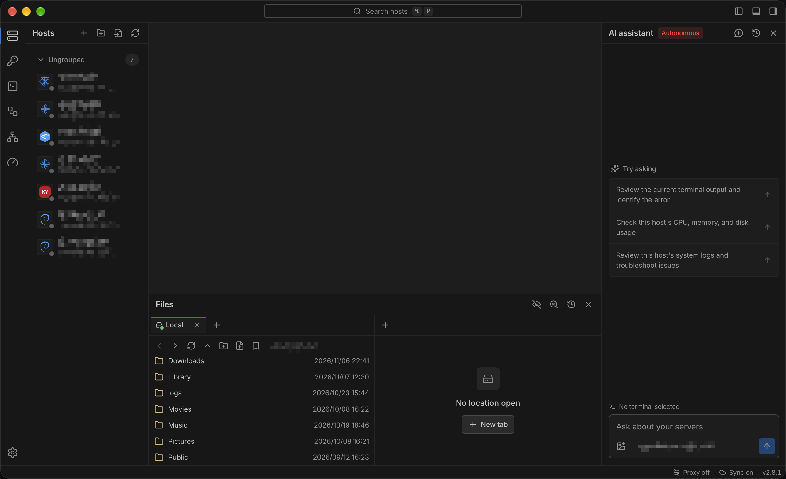

<div align="center">


# Sageport

**统一的 SSH 服务器管理工作台**

集终端会话、文件传输、资源监控、端口转发与定时任务于一体的免费开源桌面应用。

[](https://github.com/joygqz/sageport/releases/latest)
[](LICENSE)
[](https://tauri.app)

[English](README.md) · 简体中文

</div>



## 项目概述

Sageport 是一款免费开源的 SSH 服务器管理桌面应用，将终端会话、SFTP 文件传输、资源监控、端口转发与任务自动化整合到统一的工作台中。

| 功能       | 说明                                                 |
| ---------- | ---------------------------------------------------- |
| 终端会话   | 通过多标签、分屏与广播输入管理多个连接               |
| 文件管理   | 在本地与远程系统之间传输文件，并直接编辑远程文件     |
| 任务自动化 | 编排命令与文件传输，支持定时执行、失败重试和运行历史 |
| 资源监控   | 通过 SSH 查看 CPU、内存、磁盘和网络指标              |
| 命令片段   | 在一台或多台主机上复用参数化命令                     |
| 端口转发   | 管理本地、远程和动态 SSH 隧道                        |

- **无需部署代理。** 通过标准 SSH 和 SFTP 连接，无需在远程主机上安装 Sageport 代理。
- **数据本地存储。** 主机配置、凭据、设置和运行历史保存在当前设备，无需 Sageport 账号或托管服务。
- **明确的授权机制。** 通过主机密钥校验、破坏性操作确认和 AI 操作审批，帮助用户审查敏感操作。

## 功能介绍

### 终端

通过多标签和分屏管理 SSH 会话，支持会话重连、终端回滚内容搜索与命令自动补全。广播模式可向多个已连接的终端同步发送输入，便于执行批量操作。在命令面板中输入 `user@host` 即可建立临时连接，无需保存主机配置。

### 文件管理

在双栏视图中浏览本地与远程目录，通过拖拽传输文件，并对目录内容进行筛选和排序。集成的 Monaco 编辑器支持语法高亮，可直接编辑远程文件并将修改保存至服务器。递归删除支持预先扫描、并行执行和进度显示。传输记录包含源端与目标端信息。

### 任务自动化

使用本地命令、文件上传、文件下载和远程命令编排多步骤工作流。内置模板涵盖前后端部署、数据库备份、配置分发与日志收集。支持配置步骤重试次数、查看实时输出和查询持久化运行历史。

通过 cron 表达式设置任务计划。定时执行要求 Sageport 保持运行，可在前台打开窗口或在系统托盘中运行。托盘菜单提供待执行任务和活动端口转发的访问入口。

### 主机与凭据

通过分组组织主机，使用共享身份复用登录凭据，并通过跳板机链路建立连接。支持从 `~/.ssh/config` 导入主机配置，以及在应用内生成、导入和管理 SSH 密钥。

### 资源监控

查看已连接主机的 CPU、内存、磁盘和网络实时图表。监控指标通过现有 SSH 会话采集，无需部署监控代理。

### 命令片段

将常用命令保存为片段，使用 `{{variable}}` 占位符定义参数，并在执行时填写参数值。支持在单台主机或多台主机上执行，分别展示各主机的输出和执行状态。

### 端口转发

配置本地、远程和动态（SOCKS）SSH 转发，支持通过跳板机建立隧道。可在工作台中启动或停止隧道，也可为指定转发启用自动启动。

### AI 助手

使用自己的凭据和模型接入兼容 OpenAI 或 Anthropic API 的服务。助手可结合工作台上下文，建议并执行命令、管理文件和创建自动化任务。

读取终端或远程文件内容需要用户批准，其他操作遵循所配置的审批策略。自主模式允许符合条件的操作自动执行；受不可信内容影响的操作仍需重新批准。

### 同步与备份

可通过 GitHub Gist、Google Drive、OneDrive、WebDAV 或 S3 在设备之间同步配置。同步数据在上传前使用密码短语在本地加密，也可导出加密备份文件用于离线备份。

### 工作台

通过命令面板和键盘快捷键访问各项功能。界面支持明暗主题、简体中文和英文，并提供带 Schema 校验的 JSON 设置编辑器。

## 安装

从[最新版本](https://github.com/joygqz/sageport/releases/latest)下载安装包：

| 平台                            | 安装包                         |
| ------------------------------- | ------------------------------ |
| macOS（Apple Silicon 与 Intel） | 通用 `.dmg`                    |
| Windows（64 位）                | `.exe` 安装程序或便携版 `.zip` |
| Linux（64 位）                  | `.AppImage` 或 `.deb`          |

安装版支持在应用内更新。

**Windows 便携模式。** 解压便携版 `.zip` 后运行 `Sageport.exe`，无需安装。设置、主机配置、密钥和记录保存在同级的 `data` 目录中，可随应用文件夹一起迁移。便携版不支持自动更新或注册开机自启。拥有该目录文件访问权限的用户可读取其中的凭据，请妥善保护文件夹及其存储设备。

## 快速开始

1. **添加主机。** 按 <kbd>⌘</kbd> <kbd>N</kbd>，填写地址、用户名和身份验证凭据，或从 `~/.ssh/config` 导入主机。
2. **连接主机。** 在侧边栏选择主机，或按 <kbd>⌘</kbd> <kbd>P</kbd> 搜索主机名称。
3. **传输文件。** 按 <kbd>⌘</kbd> <kbd>J</kbd> 打开文件浏览器，在本地与远程面板之间拖拽文件。
4. **创建自动化任务。** 打开任务视图，选择模板、配置目标主机并运行任务。检查执行结果后，再添加定时计划。

Windows 和 Linux 使用 <kbd>Ctrl</kbd> 替代 <kbd>⌘</kbd>。

## 常见问题

**Sageport 是否需要远程代理？**
不需要。连接使用标准 SSH 和 SFTP，资源监控通过现有 SSH 会话执行系统命令。

**应用数据存储在哪里？**
Sageport 将应用数据保存在本地数据库中，无需账号或 Sageport 云服务。密码和密钥在数据库中未加密存储，请保护设备及用户文件的访问权限。

**关闭窗口后，定时任务是否继续执行？**
关闭窗口后，Sageport 继续在系统托盘中运行，定时任务仍会执行。从托盘菜单退出应用后，定时执行将停止。运行历史保存在本地。

**同步密码短语丢失后能否恢复？**
不能。同步与备份数据在上传前已在本地加密，存储服务商不会收到密码短语，开发者也无法恢复。请妥善保存密码短语。

**支持哪些 AI 服务？**
支持兼容 OpenAI 或 Anthropic API 的服务，包括商业服务和自托管服务。在应用中配置服务地址（base URL）、API 密钥和模型即可使用。请求将发送至所配置的服务，读取终端或远程文件内容需要用户批准。

## 从源码构建

安装 [Node.js](https://nodejs.org)、[pnpm](https://pnpm.io)、[Rust 工具链](https://rustup.rs)，以及对应平台的 [Tauri 2 前置依赖](https://tauri.app/start/prerequisites/)。

```sh
pnpm install
pnpm tauri dev
```

构建发布包：

```sh
pnpm tauri build
```

使用 `pnpm test` 运行前端测试。在 `src-tauri` 目录下执行 `cargo test` 运行后端测试。

Sageport 使用 Rust 后端，主要组件包括 russh、sqlx、SQLite 和 tokio；前端基于 React 19 与 TypeScript，集成 xterm.js、Monaco 和 Tailwind，通过 Tauri 2 打包为桌面应用。

## 许可证

[GPL-3.0-only](LICENSE)
